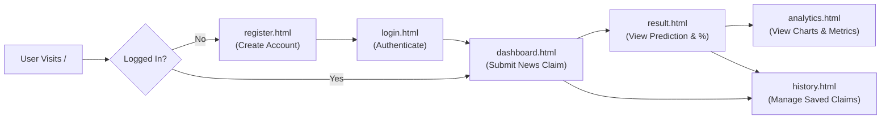

# Trust Guide – Misinformation Detector

> **Problem-Based Learning (PBL) Full-Stack Project**  
> *Bachelor of Computer Applications (BCA) Level*  
> **Tagline:** Think before you trust.

---

## 1. Project Overview

**Trust Guide** is a full-stack, database-backed web application developed to help users analyze news headlines, social media claims, and text snippets to detect sensational or misleading patterns.

The project features a **multi-page architecture**, **user authentication**, **session management**, **SQL database persistence**, and **interactive analytics with data visualizations**.

### Key Features
1. **User Authentication & Security:** Secure registration and login with SHA-256 salted password hashing and session management.
2. **Dedicated News Dashboard:** Clean input interface with sample claims, character counters, and real-time validation.
3. **Dedicated Result Display Page:** Shows assessment badges (*Potentially Misleading* vs. *Needs Verification*), True (Reliability) and False (Misleading Risk) percentages, and educational explanations.
4. **User-Specific Claim History:** Displays past claims with sequential serial numbering (`#01`, `#02`, ...), timestamp, assessment badges, direct view links, and single-click delete.
5. **Interactive Analytics Page:** Visual dashboard with summary cards, High-DPI Chart.js donut and bar charts, and overall True vs. False risk distribution bars.
6. **SQL Database Persistence:** Stores users and claims using Spring Data JPA with MySQL compatibility.

> **Academic Note:** This PBL project uses a transparent, keyword-based heuristic approach in Java to identify clickbait phrasing and sensationalism. It does not replace professional fact-checking organizations.

---

## 2. Project Directory Structure

```text
Trust guides/
├── pom.xml                               # Maven project dependencies and build configuration
├── schema.sql                            # Production SQL schema (users & news_claims tables)
├── README.md                             # Comprehensive project documentation
├── run-app.bat                           # 1-Click launcher script for Windows
├── mvn.cmd                               # VS Code / terminal helper script for Maven
├── mvnw / mvnw.cmd                       # Cross-platform Apache Maven Wrapper
├── .mvn/                                 # Maven wrapper runtime binaries
├── .vscode/                              # VS Code tasks and debugger configuration
│   ├── launch.json
│   ├── settings.json
│   └── tasks.json
├── data/                                 # Embedded SQL database directory
│   ├── trust_guide.mv.db
│   └── trust_guide.lock.db
└── src/
    ├── main/
    │   ├── java/com/datastellers/detector/
    │   │   ├── MisinformationDetectorApplication.java  # Main Spring Boot Application entry point
    │   │   ├── User.java                                # User entity (id, email, passwordHash, createdAt)
    │   │   ├── UserRepository.java                      # JPA repository for User queries
    │   │   ├── UserService.java                         # User registration, validation & auth logic
    │   │   ├── PasswordUtil.java                        # SHA-256 + Salt password hashing utility
    │   │   ├── AuthController.java                      # REST API for register, login, logout, currentUser
    │   │   ├── NewsClaim.java                           # News claim entity (id, userId, text, result, %, date)
    │   │   ├── NewsClaimRepository.java                 # JPA repository for claim history & analytics
    │   │   ├── NewsClaimService.java                    # Heuristic analysis engine & analytics aggregator
    │   │   └── NewsClaimController.java                 # REST API for claim analysis, history, and metrics
    │   └── resources/
    │       ├── application.properties                   # Database connection & Spring Boot configuration
    │       └── static/                                  # Frontend UI (HTML5, CSS3, JavaScript)
    │           ├── index.html                           # Gateway routing page (redirects to Login or Dashboard)
    │           ├── register.html                        # User registration page
    │           ├── login.html                           # User login page
    │           ├── dashboard.html                       # Main dashboard for analyzing claims
    │           ├── result.html                          # Separate result display page with percentage bars
    │           ├── history.html                         # User history page with sequential #01 numbering
    │           ├── analytics.html                       # Analytics dashboard with High-DPI charts
    │           ├── auth.js                              # Shared authentication state & header navigation
    │           └── style.css                            # Unified responsive stylesheet
    └── test/java/com/datastellers/detector/
        └── MisinformationDetectorApplicationTests.java  # Automated unit and integration tests (7 test suites)
```

---

## 3. Application Workflow



1. **Gateway (`index.html`):** Automatically checks authentication via `/api/auth/current-user`. Redirects guest users to register and logged-in users to the dashboard.
2. **Registration & Login (`register.html` & `login.html`):** Validates input format, checks email uniqueness, hashes passwords securely, and sets up session.
3. **Dashboard (`dashboard.html`):** Submits news claim to `/api/claims/analyze`.
4. **Result (`result.html`):** Fetches the saved record by ID, displays True/False percentages, and provides direct links to Analytics and History.
5. **History (`history.html`):** Displays user's claims ordered newest first, with sequential serial numbers (`#01`, `#02`), view links, and deletion.
6. **Analytics (`analytics.html`):** Computes statistics and visualizes data using Chart.js donut and bar charts with high-DPI retina display support.

---

## 4. Backend Architecture & Layers

The Java backend follows standard Spring Boot MVC architectural patterns:

| Layer | Classes | Responsibility |
| :--- | :--- | :--- |
| **Presentation / UI** | `*.html`, `style.css`, `auth.js` | Responsive user interface, asynchronous Fetch API calls, dynamic DOM manipulation. |
| **REST Controller** | `AuthController.java`, `NewsClaimController.java` | Handles HTTP requests (`POST`, `GET`, `DELETE`), session validation, JSON serialization. |
| **Service Layer** | `UserService.java`, `NewsClaimService.java` | Business logic, password hashing, heuristic text analysis, score calculation, analytics aggregation. |
| **Data Access / Repository** | `UserRepository.java`, `NewsClaimRepository.java` | Spring Data JPA interfaces for database CRUD operations and user-filtered queries. |
| **Domain Model / Entity** | `User.java`, `NewsClaim.java` | JPA entities mapped to database tables with constraints and timestamps. |
| **Security Utility** | `PasswordUtil.java` | SHA-256 cryptographic hashing with salt to protect stored credentials. |

---

## 5. Database Schema

The database schema is defined in [`schema.sql`](schema.sql) and automatically maintained by Spring Data JPA:

```sql
-- 1. Users Table
CREATE TABLE users (
    id BIGINT AUTO_INCREMENT PRIMARY KEY,
    full_name VARCHAR(150) NOT NULL,
    email VARCHAR(150) NOT NULL UNIQUE,
    password_hash VARCHAR(255) NOT NULL,
    created_at DATETIME NOT NULL DEFAULT CURRENT_TIMESTAMP
);

-- 2. News Claims Table
CREATE TABLE news_claims (
    id BIGINT AUTO_INCREMENT PRIMARY KEY,
    user_id BIGINT NULL,
    claim_text TEXT NOT NULL,
    result VARCHAR(100) NOT NULL,
    true_percentage INT NOT NULL DEFAULT 50,
    false_percentage INT NOT NULL DEFAULT 50,
    explanation TEXT NOT NULL,
    created_at DATETIME NOT NULL DEFAULT CURRENT_TIMESTAMP,
    CONSTRAINT fk_news_claims_user FOREIGN KEY (user_id) REFERENCES users(id) ON DELETE CASCADE
);
```

---

## 6. REST API Endpoints

### Authentication Endpoints (`AuthController.java`)
* `POST /api/auth/register` — Registers a new user with full name, email, and password.
* `POST /api/auth/login` — Authenticates user credentials and starts an `HttpSession`.
* `POST /api/auth/logout` — Invalidates the current user session.
* `GET /api/auth/current-user` — Returns the logged-in user profile or guest status.

### News Claim Endpoints (`NewsClaimController.java`)
* `POST /api/claims/analyze` — Analyzes a news claim, calculates True/False percentage scores, saves to SQL, and returns result JSON.
* `GET /api/claims` — Returns all claims submitted by the currently logged-in user (ordered newest first).
* `GET /api/claims/{id}` — Returns a single claim record by its ID.
* `DELETE /api/claims/{id}` — Deletes a specific claim record belonging to the user.
* `DELETE /api/claims` — Clears all claim history for the logged-in user.
* `GET /api/claims/analytics` — Returns aggregated analytics (total, misleading count, reliable count, average scores).

---

## 7. How to Run the Application

### Option A: 1-Click Launch (Windows)
Double-click [`run-app.bat`](run-app.bat) in the project root folder.

### Option B: Using Maven in Terminal
Open your terminal in the project folder and run:
```powershell
.\mvnw.cmd spring-boot:run
```
*(Or `mvn spring-boot:run` if Maven is installed globally).*

### Option C: Using Pre-Built JAR
```powershell
java -jar target/trust-guide-1.0.0.jar
```

Once started, open your web browser at:
```text
http://localhost:8080
```

---

## 8. Running Automated Unit Tests

To run the automated test suite verifying controllers, validation, hashing, heuristic detection, and JPA operations:

```powershell
.\mvnw.cmd test
```

**Expected Result:**
```text
[INFO] Tests run: 7, Failures: 0, Errors: 0, Skipped: 0
[INFO] BUILD SUCCESS
```

---

## 9. Technologies Used

* **Language:** Java 21+
* **Framework:** Spring Boot 3.5.6 (Spring Web, Spring Data JPA)
* **Database:** SQL / H2 (MySQL Mode) & standalone MySQL 8.0 compatible
* **Frontend:** HTML5, CSS3, JavaScript (Fetch API, Chart.js for data visualization)
* **Security:** SHA-256 with cryptographic salt, Spring `HttpSession`
* **Build System:** Apache Maven 3.9+
